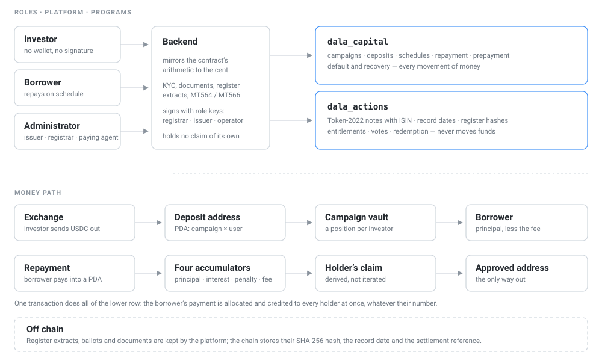

# Dala Capital

**English** · [Русский](README.ru.md)

Private credit on Solana, with the part that matters after issuance: **servicing a tokenized bond through its lifecycle** — record date, holder register, entitlement calculation, settlement, and the result written on-chain.

Kazakhstani SMEs raise USDC from offshore investors who never connect a wallet: each investor gets a personal deposit address, transfers tokens to it, and the platform credits the campaign on-chain. Money and the payment schedule live in the contract — the platform only executes operations and explains them to a human.

**Live: [app.dala-capital.live](https://app.dala-capital.live)** · devnet, real transactions

### Where everything is

| Document | What is inside | Language | For whom |
|---|---|---|---|
| **Short technical overview** (KASE.md) | The side track answered in full: the instrument, the record date, entitlement formulas, the three scenarios with devnet numbers, implemented vs simulated | [EN](KASE.md) · [RU](KASE.ru.md) | Judges, anyone evaluating the corporate-action design |
| The legal case | Two jurisdictions where the platform can be launched lawfully, with the articles of law behind each claim, and the way onto KASE's own infrastructure | [EN](LEGAL.md) · [RU](LEGAL.ru.md) | Anyone asking whether this is allowed |
| Architecture — beyond what the track asks for | Why the system is shaped this way: settlement without iterating over holders, investors without wallets, what each service key can and cannot do | [EN](docs/architecture.md) · [RU](docs/architecture.ru.md) | Anyone asking how it is built, before how it is used |
| Contract reference | Accounts, the accounting model, the life of a campaign, an entry per instruction with signer, checks and errors | [EN](smartcontracts/CONTRACT.md) · [RU](smartcontracts/CONTRACT.ru.md) | Anyone reading the programs |
| Backend README | What the service is responsible for, the module map, how the contract's arithmetic is mirrored, how to run it | [EN](backend/README.md) — English only | Backend readers |
| Frontend README | The three cabinets route by route, how the browser reaches the API | [EN](frontend/README.md) — English only | Frontend readers |
| Deployment README | The production stack, and four traps this deployment broke on | [EN](deploy/README.md) — English only | Whoever runs it |
| This README | — | EN · [RU](README.ru.md) | — |
| [LICENSE](LICENSE) | Apache 2.0 | original | — |

---

## For judges: start here

Everything below is open on the live stand. Sign in, click through, then verify the same facts in a block explorer.

### What the track asks for, and where it is

| Submission requirement | Where it is |
|---|---|
| Working prototype | [app.dala-capital.live](https://app.dala-capital.live) — devnet, real transactions, credentials below |
| Demo video | nine recordings, one per role: [Watch it work](#watch-it-work) |
| Source code repository | this repository; the layout is [below](#layout) |
| Short technical overview | [KASE.md](KASE.md) — architecture, record-date logic, entitlement calculations, settlement flow, Solana components |
| Clear distinction between implemented functionality and simulated integrations | [Implemented vs simulated](#implemented-vs-simulated), and [KASE.md §6](KASE.md) in full |

### Watch it work

Nine recordings following one issue through its whole life — creation, funding, servicing, default, redemption — one role at a time, twenty-six minutes in all. The interface is in Russian; each video's description says in English what is happening on screen.

| # | Video | Who is at the keyboard | What it shows | Length |
|---|---|---|---|---|
| 1 | [Creating a campaign and issuing a bond](https://youtu.be/4ot6p0W-mNo) | Administrator | A borrower's file, the campaign's terms, the schedule, and the Token-2022 bond issued with its ISIN and terms written into the mint | 4:29 |
| 2 | [Investing without a wallet](https://youtu.be/TMyXwwfs8NE) | Investor | A personal deposit address, a USDC transfer to it, the contribution credited on-chain, and the bond appearing in the holder's cabinet | 3:27 |
| 3 | [Closing funding and paying the borrower](https://youtu.be/FllAjHjsR2o) | Administrator | Funding closed after the deadline: the platform fee to the treasury, the proceeds to the borrower's address, and the schedule going live | 1:23 |
| 4 | [The borrower's first payment](https://youtu.be/AhVPezaLokg) | Borrower | The payment allocated by item and distributed to holders in the same transaction, and what happens to the amount paid above the instalment | 2:40 |
| 5 | [The investor withdraws a payout](https://youtu.be/mpbkOIDWidc) | Investor | A holder's share derived from their own position in the contract, paid out only to the address they registered | 1:49 |
| 6 | [The borrower pays part of the debt](https://youtu.be/AigFi6wyrjY) | Borrower | 50,000 USDC against a larger debt: interest first, then interest on arrears, then principal — the penalty is last in the queue and gets nothing | 2:42 |
| 7 | [A coupon as a corporate action](https://youtu.be/m-aWozmKf0U) | Administrator | The record date declared in advance, the holder register snapshotted against it with its hash anchored on-chain, and the action linked to the payment that settled it — MT564 before, MT566 after | 2:23 |
| 8 | [A bondholder vote as a corporate action](https://youtu.be/pTyQqO7UPBc) | Administrator, then two holders | The vote declared with a record date and a recovery-cost budget, weights taken from the snapshot rather than current balances, the tally anchored on-chain — and the default declared on its result | 4:45 |
| 9 | [Redemption as a corporate action](https://youtu.be/nitGtI3FrtM) | Administrator, then the borrower | The debt recovered in full, the redemption declared against a record date and settled, and the notes burned through the permanent delegate — supply goes to zero and the issue closes | 2:25 |

### Accounts on the stand

| Role | Login | Password | What to look at |
|---|---|---|---|
| Registrar / admin | `admin@dala.capital` | `dala-admin-2026` | Issues, corporate-action journal, holder register by name, register extracts |
| Bondholder | `holder1@dala.capital` | `dala-holder-1-2026` | Own notes, terms read from the mint, voting |
| Bondholder | `holder2@dala.capital` | `dala-holder-2-2026` | Same, a different weight in the register |
| Borrower (issuer) | `director@astana-trade.kz` | `astana-trade-2026` | Payment schedule, repayment address, early repayment |

Devnet only: the USDC is a test token and nothing on this stand has monetary value. It comes from the [SPL token faucet](https://spl-token-faucet.com/?token-name=USDC) — the same mint the platform settles in, `Gh9ZwEmdLJ8DscKNTkTqPbNwLNNBjuSzaG9Vp2KGtKJr` — so you can top yourself up and move money on the stand yourself. Investors need no wallet and no SOL: they transfer the token to a personal deposit address and the platform signs everything else.

### The three required scenarios

All three are implemented and were executed on devnet against issue **#19** (`KZ0000000021`), 1 251 notes of 1 000 USDC placed with three holders. The issue is now redeemed and its mint supply is zero — that is checkable without trusting us.

| Scenario | What the platform does | Where to see it | On-chain proof |
|---|---|---|---|
| **1. Coupon payment** | Admin declares a coupon with a record date; after that date the registrar snapshots the register and anchors its hash; `dala_capital` distributes 75 060 USDC to holders in the borrower's own payment transaction; the settlement signature is written into the action record | Admin → Облигации → issue #19 → journal, action `coupon` | [settlement transaction](https://explorer.solana.com/tx/5Sah7sx9NzhbiRACwaUSWx3KqXQVedDbStHnrveKyMmKLVV4gJDadBxdygz7nJF28f7h4MnLBASxu7wfovA85EdP?cluster=devnet) · register hash `2ed76c64a216…` |
| **2. Bond redemption** | At maturity the principal plus the final coupon — 1 060 USDC per note, 1 326 060 in total — is paid by the contract, then the registrar burns every note through the permanent delegate and the registry flips to `redeemed` | Admin → Облигации → issue #19, status «Погашена» | [mint, supply 0](https://explorer.solana.com/address/5BJzKnHrPTSTnjg7AyJhV5VsrjTNmXaJGZYhsUAdEgEa/token-extensions?cluster=devnet) |
| **3. Bondholder vote** (additional action) | A vote on declaring default, weighted by notes held **on the record date**, with the recovery-cost budget as part of the question. Ballots are cast in the cabinet; the tally and the ballot-list hash go on-chain: 851 for, 400 against, 100% turnout | Admin → journal, action `vote`; holder → «Мои бумаги» | register hash `5c85b2ef0c3b…` in the action account |

A fourth action type exists for completeness: a **record-only snapshot** with no payment, used to produce a register extract on a date. See issue #24 below.

### Minimum prototype requirements

| Required | Where it is |
|---|---|
| Test tokenized instrument | Token-2022 mint created by the program itself, terms and ISIN in its metadata: [issue #24 mint](https://explorer.solana.com/address/FZmEPxQN4KBm3HaMowHQmJWcxD2qAjayx877KsWwKpzx/token-extensions?cluster=devnet) |
| Holder registry | On-chain balances read per holder; the published list is at `GET /api/bonds/:id/register/:index`, by name on the admin screen |
| Record-date mechanism | Declared in advance; the contract refuses a snapshot before the date and settlement before a snapshot |
| Entitlement calculation | `backend/src/bonds/entitlements.ts`, unit-tested against the brief's own example (10 × $1 000 × 10% ÷ 2 = $500) |
| Coupon payment | Scenario 1 above |
| Bond redemption | Scenario 2 above |
| One additional corporate action | Scenario 3 above |
| Verifiable on-chain record | Every action is an account with status, dates, amounts, holder count, register hash and settlement signature; every transition also emits an event |

### Live issue to click through

Issue **#24** `KZ0000000062` is open right now: 751 000 USDC placed, 751 notes across three holders, coupons twice a year, first on 10 April 2027. Its journal already holds a closed record-only action, so the register extract downloads in one click.

[Mint in the explorer](https://explorer.solana.com/address/FZmEPxQN4KBm3HaMowHQmJWcxD2qAjayx877KsWwKpzx/token-extensions?cluster=devnet) · [`dala_actions` program](https://explorer.solana.com/address/7JZq4xxCLMaRefYwqgqh78skXkWrf4rtU6ArRjiokrjV?cluster=devnet) · [`dala_capital` program](https://explorer.solana.com/address/JCLPbcLwdYJs1UJgL6LK1nhYRUcGk5ziFPx55nVL9akB?cluster=devnet)

### Judging criteria, and where each one is answered

| Criterion | What answers it |
|---|---|
| Technical execution, 30% | Two Anchor programs on devnet serve the whole life of a note, from issuance to burn. The platform custodies nothing: money is moved by the contract, the platform only signs. All of it runs publicly at [app.dala-capital.live](https://app.dala-capital.live), not in a screen recording |
| Corporate action logic, 25% | Stage order is enforced by the contract, not by the interface: a snapshot before the record date, settlement without a snapshot, and a burn while the loan is unpaid are all refused. Vote weight comes from the snapshot taken on the record date, not from the current balance — otherwise one could vote, exit, and keep the vote. Entitlements follow the formula from the brief itself |
| Product & UX, 20% | Three cabinets, and each role is shown the next step rather than the whole console. The register reads as names of holders with links into their KYC files. Registrar documents download in one click: the register extract, the MT564 or MT566 notice, the action journal as a table |
| Real-world applicability, 15% | The ISIN is validated against ISO 6166 and written into the mint's metadata. Notices follow the ISO 15022 layout with `CAEV` and `CAMV` codes — the same fields depositories have used for decades. The note is registered and non-transferable, as a corporate bond is in Kazakhstan, and the keys are named after market functions: registrar, issuing agent, paying agent, treasury. [The legal case](LEGAL.md) names the two perimeters this can be launched in and shows where the platform sits next to KASE: issuance and the register stay with licensed infrastructure, the platform is the settlement and servicing layer on top |
| Innovation, 10% | A holder's entitlement is settled inside the very transaction in which the borrower pays: T+0 here is the shape of the settlement, not a promise in a rulebook. The register is kept by name, yet what goes on-chain is a fingerprint of rights, not of identity. Re-registration on an address change is one indivisible transaction — a half-applied state cannot exist |

### Implemented vs simulated

Implemented on Solana: the Token-2022 instrument with frozen holder accounts and a permanent delegate, issuance and burning, corporate-action accounts with enforced stage order, record-date checks, entitlement arithmetic, coupon and principal settlement, events on every transition.

Simulated or deliberately off-chain: the register snapshot itself (computed off-chain, published, hash anchored), ballots (cast in the cabinet, tally and hash anchored), and fiat rails (the platform settles in USDC end to end). [KASE.md §6](KASE.md) spells out each one and why.

The track allows external and fiat payment rails to be simulated, but requires the entitlement logic and the Solana-based flow to work. Both do: entitlements are computed by unit-tested pure functions and settled on-chain by `dala_capital`, and no payment in this project ever leaves Solana.

---

## Layout

| Folder | What's inside |
|---|---|
| `smartcontracts/` | Two Anchor programs. `dala_capital` — campaigns, deposits, schedules, repayments, prepayment, default and recovery. `dala_actions` — bond issuance and the corporate-actions journal |
| `backend/` | NestJS and PostgreSQL: cabinets for three roles, a client for both programs, mirrors of the contract's arithmetic, and pre-flight checks before every transaction |
| `frontend/` | Next.js: admin, investor and borrower cabinets |
| `deploy/` | The production stack: compose, Caddy, migrations, backups |
| `docs/` | The architecture document and the diagram |

## How it works



The reasoning behind each of these is in [docs/architecture.md](docs/architecture.md).

**Only the contract moves money.** The platform signs transactions with service keys but custodies nothing: deposits sit in the campaign vault, and payouts are distributed by accumulators in the same transaction in which the borrower pays. Settlement is T+0 because settlement *is* the trade.

**Four keys with different rights**, named after the functions they perform on a securities market: the registrar maintains the holder register and withdrawal whitelist, the issuing agent places the issue and declares corporate actions, the paying agent settles and credits, the treasury receives fees. In the contract they are `whitelist`, `admin`, `operator` and `treasury`.

**The contract's arithmetic is mirrored in the backend.** A deal's fields are only accurate as of its last accrual timestamp, and the program exposes no read-only instructions — so the formulas are reimplemented and checked against reference numbers from the contract's own tests.

**The holder register is stored off-chain; its hash goes on-chain.** Keeping the full list in an account would be expensive and pointless: the published list can be recomputed by anyone and verified against the anchored digest.

**The register is kept by name.** Notes are minted only to investors' withdrawal addresses and cannot be transferred, so the platform always knows who is behind an address. Identity is written into the snapshot when it is taken, not looked up later, so an extract for a past record date still shows the name of that date. The hash covers accounts, units and amounts — not names: a name is an attribute of the KYC file, and substituting it changes nobody's entitlement. Names are visible to the administrator only; investors see each other as anonymous shares.

**A move cannot half-apply.** When a holder changes their withdrawal address, the note is burned on the old account and minted on the new one in **one transaction** — a half-applied move would leave a holder without evidence of a claim they still hold. The registrar can also reconcile: compare paid-in lots against on-chain balances and re-issue what a failed transaction left missing.

**Documents a registrar hands out.** A register extract in CSV — holder, type, country, securities account, units, share of the issue, amount due — with a second, journalled export that adds identifying documents. Corporate-action notices in the ISO 15022 layout: MT564 while declared, MT566 once settled, with `CAEV`/`CAMV` codes and the ISIN. And the whole action journal as a table.

**The bond is registered, not bearer.** Holder token accounts are created frozen, so the note evidences a claim and does not circulate. The registrar holds permanent-delegate rights and burns units on redemption — supply goes to zero, visible in any explorer.

**The bond is the second instrument, not the only one.** The platform's bread and butter is the **annuity loan** an SME actually takes: equal payments, principal amortised from the first one, the schedule built by the contract when funding closes from the amount actually raised. Partial prepayment keeps the number of payments and lowers each; a missed date accrues penalty interest per second, and that penalty goes to the holders. Walked through on devnet, campaign #23: 200,000 USDC from two investors at 24% a year, four equal payments of 52,524.75, closed in full — investors ended with 105.06% of principal and the borrower's 49.99 overpayment went back to the borrower. Both instruments run on the same four accumulators and the same payout path, which is why the corporate-action work needed no change to how money moves.

## A note on language

The interface and the code comments are in Russian, and that is deliberate. The borrowers are Kazakhstani companies and the investors are Russian-speaking; localisation here is market fit, not technical debt. The comments carry the reasoning — why a number is computed one way and not another, what the contract deliberately does not do — and translating them would make them worse. Everything needed to understand the system is in English: this README, [KASE.md](KASE.md), [docs/architecture.md](docs/architecture.md) and [the contract reference](smartcontracts/CONTRACT.md).

## Running it

Requires Node 24, Docker, and Rust with Anchor 0.31 for the programs.

```bash
# database
cd backend && docker compose up -d

# backend: migrations and start
cd backend && pnpm install && npx prisma migrate dev && pnpm start

# frontend
cd frontend && pnpm install && pnpm dev --port 3100

# programs
cd smartcontracts && anchor build && anchor test
```

Environment variables follow `backend/.env.example`. Role keypairs live in `backend/.secrets/` and never enter the repository.

## Tests

```bash
cd backend && pnpm test && pnpm test:e2e
cd smartcontracts && anchor test
```

185 unit and 192 end-to-end tests in the backend, 25 unit and 102 integration tests in the contracts, 36 of them for bonds. Both programs are deployed on devnet and the full lifecycle has been walked through live on realistic amounts — the numbers and the walkthrough are in [KASE.md](KASE.md).
