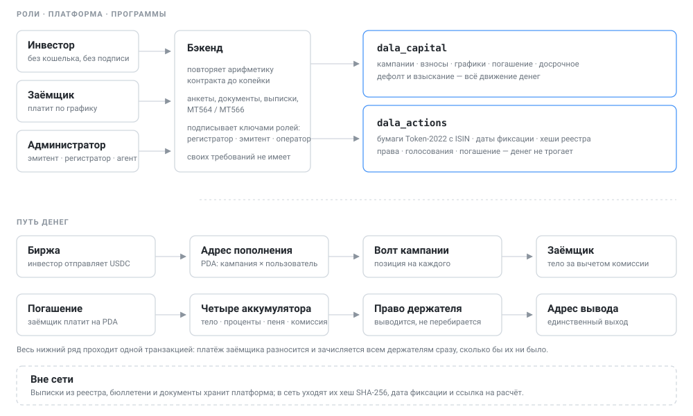

# Dala Capital

[English](README.md) · **Русский**

Частное кредитование на Solana: иностранные инвесторы вносят USDC на персональные адреса пополнения без подключения кошелька, заёмщики — казахстанские ТОО. Деньги и график платежей живут в контракте, платформа только проводит операции и объясняет их человеку.

Две схемы займа. **Кредит** — аннуитетный график, доля инвестора существует только в контракте. **Облигация** — купоны и тело в конце, у держателя на руках именная бумага Token-2022, а корпоративные действия по ней ведутся отдельной программой: дата фиксации, список держателей, расчёт прав, голосование.

**Стенд в сети: [app.dala-capital.live](https://app.dala-capital.live)** — devnet, операции настоящие.

### Где что лежит

| Документ | Что внутри | Язык | Кому |
|---|---|---|---|
| KASE | Трек целиком: инструмент, дата фиксации, формулы расчёта прав, три сценария с числами из devnet, что сделано и что изображено | [EN](KASE.md) · [RU](KASE.ru.md) | Жюри и всем, кто оценивает устройство корпоративных действий |
| Устройство системы | Почему система устроена именно так: расчёт без перебора держателей, инвесторы без кошельков, что служебный ключ может и чего не может | [EN](docs/architecture.md) · [RU](docs/architecture.ru.md) | Тем, кому важно устройство, а не функции |
| Справочник контракта | Аккаунты, модель учёта, жизнь кампании, по разделу на инструкцию — подписант, проверки, ошибки | [EN](smartcontracts/CONTRACT.md) · [RU](smartcontracts/CONTRACT.ru.md) | Тем, кто читает программы |
| README бэкенда | За что отвечает сервис, карта модулей, зачем расчёты контракта продублированы, как запустить | [EN](backend/README.md) — только по-английски | Тем, кто читает бэкенд |
| README фронта | Три кабинета по маршрутам, как браузер попадает в API | [EN](frontend/README.md) — только по-английски | Тем, кто читает фронт |
| README выкладки | Боевая выкладка и четыре места, на которых она спотыкалась | [EN](deploy/README.md) — только по-английски | Тем, кто это держит |
| Этот README | — | [EN](README.md) · RU | — |
| [LICENSE](LICENSE) | Apache 2.0 | оригинал | — |

---

## Жюри: начните отсюда

Всё, что ниже, открыто на стенде. Войдите, прощёлкайте — и проверьте те же факты в обозревателе блоков.

### Как это выглядит

Восемь записей: один выпуск от создания до голосования держателей об объявлении дефолта, в каждой — одна роль, двадцать четыре минуты вместе. Интерфейс русский, описание под каждым роликом — английское.

| № | Видео | Кто за клавиатурой | Что видно | Длина |
|---|---|---|---|---|
| 1 | [Создание кампании и выпуск облигации](https://youtu.be/4ot6p0W-mNo) | Администратор | Карточка заёмщика, условия кампании, график и выпуск бумаги Token-2022: ISIN и условия записываются внутрь минта | 4:29 |
| 2 | [Инвестор вносит деньги без кошелька](https://youtu.be/TMyXwwfs8NE) | Инвестор | Персональный адрес пополнения, перевод USDC на него, зачисление взноса в сети и бумага, появившаяся в кабинете держателя | 3:27 |
| 3 | [Закрытие сбора и выдача денег заёмщику](https://youtu.be/FllAjHjsR2o) | Администратор | Сбор закрывается после дедлайна: комиссия платформы в казну, собранное — на адрес заёмщика, график становится действующим | 1:23 |
| 4 | [Первый платёж заёмщика](https://youtu.be/AhVPezaLokg) | Заёмщик | Поступление разносится по статьям и попадает держателям в той же транзакции; видно и то, что происходит с переплатой | 2:40 |
| 5 | [Инвестор забирает выплату](https://youtu.be/mpbkOIDWidc) | Инвестор | Доля держателя считается из его позиции в контракте и уходит только на зарегистрированный им адрес | 1:49 |
| 6 | [Заёмщик вносит часть долга](https://youtu.be/AigFi6wyrjY) | Заёмщик | 50 000 USDC при большем долге: сначала проценты, затем проценты на просрочку, затем тело — пеня последняя в очереди и не получает ничего | 2:42 |
| 7 | [Купон как корпоративное действие](https://youtu.be/m-aWozmKf0U) | Администратор | Дата фиксации объявлена заранее, реестр снят на неё, хеш списка ушёл в сеть, а само действие связано с транзакцией, которой заплатили: MT564 до исполнения, MT566 после | 2:23 |
| 8 | [Голосование держателей как корпоративное действие](https://youtu.be/pTyQqO7UPBc) | Администратор и два держателя | Голосование объявлено с датой фиксации и бюджетом взыскания, веса взяты из снимка, а не из текущих балансов, итог записан в сеть — и по нему объявлен дефолт | 4:45 |

### Доступы на стенде

| Роль | Логин | Пароль | На что смотреть |
|---|---|---|---|
| Регистратор, он же админ | `admin@dala.capital` | `dala-admin-2026` | Выпуски, журнал корпоративных действий, реестр держателей поимённо, выписки |
| Держатель бумаг | `holder1@dala.capital` | `dala-holder-1-2026` | Свои бумаги, условия, прочитанные из минта, голосование |
| Держатель бумаг | `holder2@dala.capital` | `dala-holder-2-2026` | То же, но другой вес в реестре |
| Заёмщик, он же эмитент | `director@astana-trade.kz` | `astana-trade-2026` | График платежей, адрес погашения, досрочное погашение |

Это devnet: USDC здесь тестовый, денежной ценности на стенде нет ни у чего. Берётся он из [крана SPL](https://spl-token-faucet.com/?token-name=USDC) — тот же минт, которым платформа и рассчитывается, `Gh9ZwEmdLJ8DscKNTkTqPbNwLNNBjuSzaG9Vp2KGtKJr`, — так что пополнить себя и подвигать деньги на стенде можно самостоятельно. Инвестору не нужны ни кошелёк в программе, ни SOL: он переводит токен на личный адрес пополнения, остальное подписывает платформа.

### Три обязательных сценария

Все три сделаны и пройдены на devnet по выпуску **№19** (`KZ0000000021`): 1 251 бумага номиналом 1 000 USDC у трёх держателей. Выпуск погашен, supply минта — ноль, и это проверяется без доверия к нам.

| Сценарий | Что делает платформа | Где посмотреть | Доказательство в сети |
|---|---|---|---|
| **1. Выплата купона** | Админ объявляет купон с датой фиксации; после неё регистратор снимает реестр и записывает его хеш в сеть; `dala_capital` раздаёт держателям 75 060 USDC в той же транзакции, которой платит заёмщик; подпись расчёта пишется в запись действия | Админ → «Облигации» → выпуск №19 → журнал, действие «Купон» | [транзакция расчёта](https://explorer.solana.com/tx/5Sah7sx9NzhbiRACwaUSWx3KqXQVedDbStHnrveKyMmKLVV4gJDadBxdygz7nJF28f7h4MnLBASxu7wfovA85EdP?cluster=devnet) · хеш реестра `2ed76c64a216…` |
| **2. Погашение бумаг** | В дату зрелости тело с последним купоном — 1 060 USDC на бумагу, 1 326 060 всего — платит контракт, затем регистратор прожигает бумаги через постоянного делегата, и выпуск становится `redeemed` | Админ → «Облигации» → выпуск №19, значок «Погашена» | [минт, supply 0](https://explorer.solana.com/address/5BJzKnHrPTSTnjg7AyJhV5VsrjTNmXaJGZYhsUAdEgEa/token-extensions?cluster=devnet) |
| **3. Голосование держателей** (дополнительное действие) | Голосование по объявлению дефолта с весом по бумагам **на дату фиксации** и с бюджетом взыскания в самом вопросе. Бюллетени подаются в кабинете, в сеть уходят итог и хеш списка: 851 за, 400 против, явка 100% | Админ → журнал, действие «Голосование»; держатель → «Мои бумаги» | хеш реестра `5c85b2ef0c3b…` в аккаунте действия |

Есть и четвёртый вид действия — **служебный реестр без выплаты**: снимок на дату, из которого получается выписка. Он показан на выпуске №24.

### Минимальные требования прототипа

| Требование | Где это |
|---|---|
| Тестовый токенизированный инструмент | Минт Token-2022, созданный самой программой; условия и ISIN в его метаданных: [минт выпуска №24](https://explorer.solana.com/address/FZmEPxQN4KBm3HaMowHQmJWcxD2qAjayx877KsWwKpzx/token-extensions?cluster=devnet) |
| Реестр держателей | Балансы читаются из сети по каждому держателю; опубликованный список — `GET /api/bonds/:id/register/:index`, поимённо — на экране админа |
| Механизм даты фиксации | Объявляется заранее; контракт отказывает и в снятии реестра до даты, и в исполнении без снятого реестра |
| Расчёт прав | `backend/src/bonds/entitlements.ts`, покрыт тестами по примеру из самого задания (10 × $1 000 × 10% ÷ 2 = $500) |
| Выплата купона | Сценарий 1 |
| Погашение облигации | Сценарий 2 |
| Одно дополнительное корпоративное действие | Сценарий 3 |
| Проверяемая запись результата в сети | Каждое действие — аккаунт со статусом, датами, суммами, числом держателей, хешем реестра и подписью расчёта; каждый переход ещё и порождает событие |

### Выпуск, который можно щёлкать прямо сейчас

Выпуск **№24** `KZ0000000062` действует: размещено 751 000 USDC, 751 бумага у трёх держателей, купон дважды в год, первый 10 апреля 2027. В журнале уже лежит закрытый служебный реестр, поэтому выписка скачивается одним нажатием.

[Минт в обозревателе](https://explorer.solana.com/address/FZmEPxQN4KBm3HaMowHQmJWcxD2qAjayx877KsWwKpzx/token-extensions?cluster=devnet) · [программа `dala_actions`](https://explorer.solana.com/address/7JZq4xxCLMaRefYwqgqh78skXkWrf4rtU6ArRjiokrjV?cluster=devnet) · [программа `dala_capital`](https://explorer.solana.com/address/JCLPbcLwdYJs1UJgL6LK1nhYRUcGk5ziFPx55nVL9akB?cluster=devnet)

### Критерии оценки и чем закрыт каждый

| Критерий | Чем закрыт |
|---|---|
| Техническое исполнение, 30% | Две программы Anchor на devnet обслуживают весь жизненный цикл бумаги — от выпуска до прожига. Платформа не хранит средства: деньги двигает контракт, платформа лишь подписывает операции. Всё это работает публично на [app.dala-capital.live](https://app.dala-capital.live), а не в записи экрана |
| Логика корпоративных действий, 25% | Порядок стадий держит контракт, а не интерфейс: реестр до даты фиксации, исполнение без снятого реестра и прожиг при непогашенном займе он отвергает. Вес голоса берётся из снимка на дату фиксации, а не из текущего баланса, — иначе можно было бы проголосовать и выйти. Расчёт прав повторяет формулу из самого задания |
| Продукт и UX, 20% | Три кабинета, и каждой роли показан ровно следующий шаг, а не весь пульт. Реестр читается именами держателей со ссылками в анкеты. Документы регистратора скачиваются одним нажатием: выписка из реестра, уведомление MT564 или MT566, журнал действий таблицей |
| Применимость в жизни, 15% | ISIN проверяется по ISO 6166 и пишется в метаданные минта. Уведомления идут в раскладке ISO 15022 с кодами `CAEV` и `CAMV` — ими депозитарии описывают корпоративные действия не первое десятилетие. Бумага именная и непередаваемая, как корпоративная облигация в Казахстане, а ключи названы по функциям рынка: регистратор, эмиссионный агент, платёжный агент, казна |
| Новизна, 10% | Право держателя закрывается в той же транзакции, которой платит заёмщик: T+0 здесь не обещание регламента, а устройство расчёта. Реестр ведётся поимённо, но в сеть уходит отпечаток прав, а не личности. Перерегистрация при смене адреса — одна неделимая транзакция, половинчатого состояния не бывает |

### Что сделано, а что изображено

Сделано на Solana: инструмент Token-2022 с замороженными счетами держателей и постоянным делегатом, выпуск и прожиг, аккаунты корпоративных действий с принудительным порядком стадий, проверки даты фиксации, расчёт прав, выплата купона и тела, события на каждом переходе.

Изображено или намеренно вне цепочки: сам снимок реестра (считается офчейн, публикуется, в сеть идёт хеш), бюллетени (подаются в кабинете, в сеть идут итог и хеш) и фиатные рельсы — платформа рассчитывается в USDC от начала до конца. Каждый случай разобран в [KASE.ru.md, раздел 6](KASE.ru.md).

---

## Что где

| Папка | Что внутри |
|---|---|
| `smartcontracts/` | Две программы Anchor. `dala_capital` — кампании, взносы, график, платежи, досрочное погашение, дефолт и взыскание. `dala_actions` — выпуск облигации и журнал корпоративных действий |
| `backend/` | NestJS и PostgreSQL: кабинеты трёх ролей, клиент обеих программ, зеркала расчётов контракта, проверки перед отправкой транзакций |
| `frontend/` | Next.js: кабинеты админа, инвестора и заёмщика |
| `deploy/` | Боевая выкладка: compose, Caddy, миграции, бэкапы |
| `docs/` | Документ про устройство системы и схема |

## Как это устроено



Почему именно так — в [docs/architecture.ru.md](docs/architecture.ru.md).

**Деньги двигает только контракт.** Платформа подписывает транзакции служебными ключами, но не хранит средства: взносы лежат в волте кампании, выплаты распределяются аккумуляторами в тот же момент, когда платит заёмщик.

**Четыре ключа с разными правами** — регистратор ведёт допуск и реестр держателей, эмиссионный агент размещает выпуск и объявляет корпоративные действия, платёжный агент проводит расчёты, казна принимает комиссии.

**Расчёты контракта продублированы на бэкенде.** Поля сделки верны только на момент последнего начисления, а read-only инструкций у программы нет — поэтому формулы повторены и сверены с эталонными числами из тестов контракта.

**Реестр держателей хранится у платформы, в сеть уходит его хеш.** Держать список целиком на блокчейне дорого и незачем: опубликованный список пересчитывается кем угодно и сверяется с отпечатком.

**Перенос бумаг нельзя применить наполовину.** При смене адреса вывода бумага гасится на старом счёте и выпускается на новом **одной транзакцией**: половинчатый перенос оставил бы держателя без доказательства права, которое у него никуда не делось. У регистратора есть и сверка реестра — сравнить оформленные взносы с балансами в сети и довыпустить то, что потеряла неподтверждённая транзакция.

**Реестр ведётся поимённо.** Бумаги выпускаются только на адреса вывода инвесторов и не передаются, поэтому связь «адрес → человек» платформе известна всегда. Имя, тип и страна пишутся в снимок в момент составления, а не берутся из анкеты при чтении, — иначе выписка на прошлую дату показала бы держателя под новым именем. Хеш покрывает счета, бумаги и суммы, но не имена: имя — атрибут анкеты, его подмена ничьих прав не меняет. Имена видит только админ, инвесторы видят друг друга анонимно.

**Что регистратор отдаёт наружу.** Выписку из реестра в CSV — держатель, тип, страна, лицевой счёт, бумаги, доля в выпуске, причитающаяся сумма — и вторую выгрузку с удостоверяющими документами, которая пишется в журнал админа. Уведомления о корпоративных действиях в раскладке ISO 15022: MT564, пока действие объявлено, MT566 после исполнения, с кодами `CAEV`/`CAMV` и ISIN. И весь журнал действий таблицей.

**Бумага именная, а не на предъявителя.** Токен-счета держателей создаются замороженными: бумага удостоверяет требование и не обращается. У регистратора права постоянного делегата, и при погашении он гасит бумаги — предложение уходит в ноль, это видно в любом обозревателе.

**Облигация — второй инструмент, а не единственный.** Основная работа платформы — **аннуитетный заём**, который и берёт МСБ: равные платежи, тело гасится с первого, график строит контракт при закрытии сбора и считает его от фактически собранного. Частичное досрочное погашение уменьшает платежи, не меняя их числа; просрочка начисляет пеню посекундно, и пеня достаётся держателям, а не платформе. Пройдено на devnet, кампания №23: 200 000 USDC от двух инвесторов под 24% годовых, четыре равных платежа по 52 524,75, закрыта полностью — инвесторы получили 105,06% вложенного, переплата 49,99 вернулась заёмщику. Оба инструмента считаются одними и теми же четырьмя аккумуляторами и ходят одним и тем же путём выплат — поэтому корпоративные действия удалось построить сверху, не трогая движение денег.

## О языке

Интерфейс и комментарии в коде — русские, и это намеренно. Заёмщики — казахстанские компании, инвесторы говорят по-русски; локализация здесь не технический долг, а попадание в рынок. В комментариях лежат рассуждения — почему число считается так, а не иначе, чего контракт намеренно не делает, — и перевод сделал бы их хуже. Для англоязычного читателя переведены все документы, которые нужны, чтобы понять систему: [README](README.md), [KASE.md](KASE.md), [docs/architecture.md](docs/architecture.md) и [справочник контракта](smartcontracts/CONTRACT.md).

## Запуск

Нужны Node 24, Docker и Rust с Anchor 0.31 для контрактов.

```bash
# база
cd backend && docker compose up -d

# бэкенд: миграции и старт
cd backend && pnpm install && npx prisma migrate dev && pnpm start

# фронтенд
cd frontend && pnpm install && pnpm dev --port 3100

# контракты
cd smartcontracts && anchor build && anchor test
```

Переменные окружения — по образцу `backend/.env.example`. Ключи ролей кладутся в `backend/.secrets/` и в репозиторий не попадают.

## Тесты

```bash
cd backend && pnpm test && pnpm test:e2e
cd smartcontracts && anchor test
```
